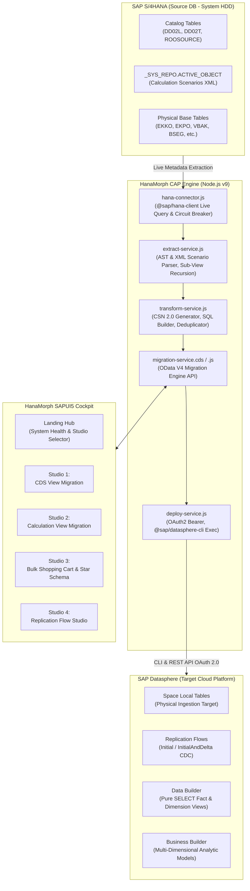

# HanaMorph: CDS & Calculation View to SAP Datasphere Migration Tool
## Enterprise Technical Architecture & Developer Documentation

---

## 📑 Table of Contents
1. [Executive Overview & Purpose](#1-executive-overview--purpose)
2. [End-to-End System Architecture](#2-end-to-end-system-architecture)
3. [The 4 Core Functional Studios (UI Cockpit)](#3-the-4-core-functional-studios-ui-cockpit)
   - [Studio 1: CDS View Migration Studio](#studio-1-cds-view-migration-studio)
   - [Studio 2: Calculation View Migration Studio](#studio-2-calculation-view-migration-studio)
   - [Studio 3: Bulk Multi-View Migration Studio ("Shopping Cart" Pattern)](#studio-3-bulk-multi-view-migration-studio-shopping-cart-pattern)
   - [Studio 4: Dedicated Replication Flow Studio](#studio-4-dedicated-replication-flow-studio)
4. [Deep-Dive Core Engine Architecture (`srv/lib`)](#4-deep-dive-core-engine-architecture-srvlib)
   - [Extract Service (`srv/lib/extract-service.js`)](#41-extract-service-srvlibextract-servicejs)
   - [Transform Service (`srv/lib/transform-service.js`)](#42-transform-service-srvlibtransform-servicejs)
   - [Deploy Service (`srv/lib/deploy-service.js`)](#43-deploy-service-srvlibdeploy-servicejs)
   - [HANA Connector (`srv/lib/hana-connector.js`)](#44-hana-connector-srvlibhana-connectorjs)
   - [Configuration Manager (`srv/lib/config.js`)](#45-configuration-manager-srvlibconfigjs)
5. [Database Data Model (`db/schema.cds`)](#5-database-data-model-dbschemacds)
6. [Complete OData V4 API Reference (`srv/migration-service.cds`)](#6-complete-odata-v4-api-reference-srvmigration-servicecds)
7. [SAP Datasphere Artifact Specifications & CSN Rules](#7-sap-datasphere-artifact-specifications--csn-rules)
   - [100% Self-Contained CSN Guarantee](#100-self-contained-csn-guarantee)
   - [Multi-Tier DAG Generation](#multi-tier-dag-generation)
   - [Star Schema & Associations](#star-schema--associations)
   - [Pure SELECT SQL vs Canvas Views](#pure-select-sql-vs-canvas-views)
   - [Native Replication Flow JSON Schema](#native-replication-flow-json-schema)
8. [Setup, Configuration & Secrets](#8-setup-configuration--secrets)
9. [Local Development, Build & Cloud Foundry Deployment](#9-local-development-build--cloud-foundry-deployment)
10. [Automated Verification & Auditing Suite](#10-automated-verification--auditing-suite)
11. [Troubleshooting & Frequently Asked Questions](#11-troubleshooting--frequently-asked-questions)

---

## 1. Executive Overview & Purpose

### 1.1 The Business Challenge
SAP organizations modernizing their analytics landscape face a monumental task: migrating decades of business logic built into **SAP S/4HANA ABAP CDS Views** and **HANA Calculation Views** into **SAP Datasphere** (formerly SAP Data Warehouse Cloud). 

Manual migration suffers from critical roadblocks:
1. **Dependency Resolution Failures:** Importing raw CSN into SAP Datasphere regularly fails with missing object reference errors (`query.SELECT.from.ref` and `#field` mismatch).
2. **SQL Dialect Incompatibilities:** S/4HANA CDS SQL and calculation scenarios use proprietary syntax that breaks when pasted into the Datasphere SQL View Canvas (e.g., `CREATE VIEW` wrapper errors, unhandled NULL measures).
3. **Storage Bloat from Redundant Ingestion:** Multiple views reference identical physical source tables (e.g., `EKKO`, `EKPO`, `MARA`, `VBAK`), causing redundant data extraction and high storage consumption.
4. **Coupled Ingestion & Modeling:** Traditional tools mix physical data replication with consumption modeling, complicating governance and data engineering pipelines.

### 1.2 The HanaMorph Solution
**HanaMorph** is an enterprise-grade migration cockpit and transformation engine built on **SAP Cloud Application Programming Model (CAP Node.js v9)** and **SAPUI5**. It automates the discovery, extraction, AST-parsing, semantic translation, deduplication, and deployment of S/4HANA CDS Views and HANA Calculation Views into SAP Datasphere.

```
┌─────────────────────────────────────────────────────────────────────────────┐
│                                 HANAMORPH                                   │
│  S/4HANA CDS & Calculation View to SAP Datasphere Automated Migration Engine │
└─────────────────────────────────────────────────────────────────────────────┘
  ✓ 120,000+ Views Live Type-Ahead Discovery (<30ms)
  ✓ ABAP CDS DDL & Calculation View XML Parser (AST & DAG)
  ✓ 100% Self-Contained CSN Packages ($version: "2.0", Zero Missing References)
  ✓ Automated Physical Table Deduplication & Source Rationalization
  ✓ Star Schema Data Mart Modeling with native cds.Association
  ✓ Decoupled Master/Delta Ingestion with Native Replication Flows via CLI
```

---

## 2. End-to-End System Architecture



### Data Journey Lifecycle:
1. **Live Discovery:** User queries the catalog. The engine searches over 120k views in SAP S/4HANA via debounced live SQL (`hanaConnector.searchViews`).
2. **Extraction & Parsing:** The raw ABAP CDS DDL or Calculation Scenario XML is extracted and converted into a normalized internal JSON AST (`extractService`). Nested sub-views are recursively resolved down to base physical tables.
3. **Semantic Transformation:** The model is converted to:
   - Self-contained CSN 2.0 JSON with strict key and measure annotations (`@Analytics.measure`, `@Aggregation.default: '#SUM'`).
   - Pure SELECT SQL canvas statements (with `COALESCE` null-safe wrappers).
   - Star Schema CSN linking Fact Views to Dimensions using `cds.Association`.
   - Native Datasphere Replication Flow definition JSONs.
4. **Target Deployment:** Local Tables and Replication Flows are deployed to SAP Datasphere via `@sap/datasphere-cli` using live OAuth Bearer tokens (`deployService`).

---

## 3. The 4 Core Functional Studios (UI Cockpit)

The HanaMorph cockpit is structured into 4 purpose-built studios to keep workflows decoupled, fast, and audit-compliant:

### Studio 1: CDS View Migration Studio
*Target Persona:* ABAP / Data Engineers migrating SAP S/4HANA Core Data Services.

- **Type-Ahead Live Search:** Filter through SAP modules (MM, SD, FI, CO, PP, QM, PM) or custom `Z*`/`Y*` views with response times under 30ms.
- **5-Step Guided Wizard:**
  1. **Select CDS View:** Live table with status badges (`★ Verified Ready`, `Custom Eclipse`, `Standard`).
  2. **Artifacts (Dynamic Inspection):** Detects whether the view has joins/associations. Single-source views show only physical `TABLE` and `SQL` artifacts; multi-source views enable relational join diagrams.
  3. **Columns:** Live field selector with column renaming, key toggling, and measure semantics (`#SUM`, `#COUNT`, `#MIN`, `#MAX`).
  4. **Object Naming & Target Space:** Configure target space (e.g., `AIS_INBOUND` or `AIS_HARMONIZATION_`) with verified `fromTableName` references.
  5. **Code & Downloads:** Direct download of:
     - Complete CSN Package (`*_complete_package.csn.json`)
     - Self-Contained Fact View CSN (`*_view.csn.json`)
     - Standalone Fact Entity CSN (`*_standalone_fact.csn.json`)
     - Base Physical Ingestion Table CSN (`*_table.csn.json`)
     - Pure SELECT SQL Canvas statement (`*_view.sql`)

### Studio 2: Calculation View Migration Studio
*Target Persona:* HANA Modelers migrating classical Calculation Views (`CA_*`, `CV_*`).

- **Active Scenario Parser:** Direct extraction from `_SYS_REPO.ACTIVE_OBJECT`.
- **Node DAG Parsing:** Automatically reconstructs scenario graphs with `join`, `projection`, `aggregation`, and `union` nodes.
- **Recursive Sub-View Resolution:** Automatically unpacks nested calculation views down to underlying physical database tables (up to depth 5), flattening dependencies to prevent circular locks.
- **Measure Aggregation Preservation:** Automatically identifies aggregation types (`SUM`, `MAX`, `MIN`) and converts them into Datasphere Analytic Model consumption rules.

### Studio 3: Bulk Multi-View Migration Studio ("Shopping Cart" Pattern)
*Target Persona:* Enterprise Data Architects migrating entire business processes or functional domains.

- **Shopping Cart Accumulation:** Search across different SAP modules, check boxes, and stage views in a central "Review Cart".
- **Source Rationalization & Deduplication:**
  - Identifies overlapping physical tables (e.g., 5 views all reading `VBAK` and `VBAP`).
  - Merges duplicate tables into a **Single Master Superset Ingestion Table** per source.
  - Generates an optimal **Deduplicated Replication Flow** reducing network traffic and Datasphere storage footprint.
- **Star Schema Data Mart Generator:**
  - Select one central **Fact View** and multiple **Dimension Views**.
  - Automatically establishes `cds.Association` foreign key joins between fact foreign keys and dimension primary keys.
  - Produces a single, self-contained Star Schema CSN and multi-table SQL script.

### Studio 4: Dedicated Replication Flow Studio
*Target Persona:* Data Engineers and Integration Specialists setting up ingestion pipelines.

- **Decoupled Physical Ingestion:** Separates the ingestion layer from analytical modeling.
- **Automated Ingestion Modes:**
  - **Master Data / Configuration:** Automatically sets load type to `InitialOnly` (snapshot replication).
  - **Transactional Data:** Automatically sets load type to `InitialAndDelta` with Change Data Capture (CDC) enabled.
- **Direct CLI Execution:** One-click deployment (`objects replication-flows create`) and real-time execution (`tasks replication-flows run`) via `@sap/datasphere-cli`.

---

## 4. Deep-Dive Core Engine Architecture (`srv/lib`)

The backend processing logic resides in modular service libraries under `srv/lib/`:

### 4.1 Extract Service (`srv/lib/extract-service.js`)
Responsible for reading raw definitions from SAP HANA (or mock catalogs) and compiling them into a standardized internal Abstract Syntax Tree (AST).

- **`extractCDS(viewName)`**:
  - Pulls ABAP CDS DDL from `hanaConnector.getCdsViewDefinition(viewName)`.
  - Cleans comments (`/* ... */`, `//`, `--`).
  - Balanced curly-bracket parser parses column definitions while respecting nested CDS annotations (`@UI`, `@Semantics`, etc.).
  - Extracts source tables and joins from `select from` and `join` clauses.
- **`extractCalc(viewName, depth, visited)`**:
  - Fetches XML definition from `_SYS_REPO.ACTIVE_OBJECT` where `package_id` and `object_name` match.
  - Parses XML with `fast-xml-parser`.
  - Maps `logicalModel.attributes` and `logicalModel.baseMeasures`.
  - Analyzes calculation scenario nodes (`ProjectionView`, `JoinView`, `UnionView`, `AggregationView`).
  - Recursively calls `extractCalc` for nested calculation views, maintaining a deduplicated map of physical source tables (`allPhysicalSources`).

### 4.2 Transform Service (`srv/lib/transform-service.js`)
The core semantic and CSN compiler. It ensures 100% adherence to SAP Datasphere Data Builder and Business Builder schemas.

- **`generateModularArtifacts(model, selectedColumns, namingConfig)`**:
  - Compiles the internal model into 6 modular artifacts (Table CSN, View CSN, Analytic Model CSN, Complete Package, Multi-Tier DAG CSN, and SQL).
- **`generateStarSchemaPackage(factModel, dimensionModels, options)`**:
  - Analyzes join keys between Fact View and Dimension Views.
  - Injects `cds.Association` definitions into the Fact View pointing to target Dimension Views.
  - Produces a validated, 100% self-contained multi-entity CSN package.
- **`extractAndDeduplicateTables(models)`**:
  - Takes an array of view models, extracts all underlying physical tables, and merges overlapping column definitions into a single superset table per physical entity.
- **`generateDeduplicatedMultiTableReplicationPackage(models, options)`**:
  - Creates a synchronized Datasphere CSN bundle for all target local tables along with a unified multi-task Replication Flow JSON.
- **`_hydrateTableWithCatalog(tblName, tblDef)`**:
  - Enriches physical table definitions with verified data types, lengths, and primary keys from `srv/fixtures/table-columns-catalog.json`.

### 4.3 Deploy Service (`srv/lib/deploy-service.js`)
Automates integration with SAP Datasphere using official CLI tools and REST APIs.

- **OAuth 2.0 Bearer Token Management:**
  - Connects to SAP Datasphere OAuth endpoint (`tokenUrl`) using `clientId` and `clientSecret`.
  - Caches the active Bearer token and refreshes it automatically 60 seconds before expiration.
- **Datasphere CLI Orchestration (`@sap/datasphere-cli`):**
  - Executes CLI commands using temporary staging files (`os.tmpdir()`).
  - Handles CLI session authentication (`datasphere-cli login --host ... --access-token ...`).
  - Creates Local Tables: `datasphere-cli objects local-tables create --space ... --file-path ...`
  - Creates Replication Flows: `datasphere-cli objects replication-flows create --space ... --file-path ... --save-anyway --allow-missing-dependencies`
  - Runs Replication Flows: `datasphere-cli tasks replication-flows run --space ... --technical-name ...`
  - Inspects Task Status: `datasphere-cli tasks replication-flows status --space ... --technical-name ...`

### 4.4 HANA Connector (`srv/lib/hana-connector.js`)
Manages live connectivity to the SAP S/4HANA underlying database.

- **Connection Pool:** Uses `@sap/hana-client` connecting to host/port (e.g. `192.168.1.55:31015`, user `DINESH_S`).
- **Circuit Breaker:** Implements a 20-second failure cooldown to protect against connection storms when network drops occur.
- **Curated Verification Badges:** Prioritizes verified enterprise views (`E2E_VERIFIED_CDS`, `E2E_VERIFIED_CALC`) with a `★ Verified Ready` badge.
- **Live Search Optimization:** Uses optimized SQL queries against S/4HANA catalog views with `LIKE` filters and result limits for sub-30ms performance.

### 4.5 Configuration Manager (`srv/lib/config.js`)
Provides unified access to credentials and operational settings.
- Prioritizes environment variables (`HANA_HOST`, `DATASPHERE_CLIENT_ID`, etc.) over `config.json`.
- Supports toggle for `USE_MOCK` (true/false) to enable seamless development and testing in sandboxed environments without direct VPN/network connectivity.

---

## 5. Database Data Model (`db/schema.cds`)

HanaMorph maintains state, catalogs, and migration job history in an internal SQLite / HANA persistence layer:

```cds
namespace hanamorph;

using { cuid, managed } from '@sap/cds/common';

type ViewType : String enum {
    CDS;
    CALC_VIEW;
};

type JobStatus : String enum {
    PENDING;
    EXTRACTING;
    TRANSFORMING;
    DEPLOYING;
    LOADING;
    COMPLETED;
    FAILED;
};

type LogLevel : String enum {
    INFO;
    WARN;
    ERROR;
};

entity SourceCatalog {
    key name            : String(120);
    type                : ViewType;
    sqlViewName         : String(120);
    description         : String(255);
    packageOrSchema     : String(120);
    columnCount         : Integer default 0;
    hasAggregations     : Boolean default false;
    supportedStatus     : String(30) default 'SUPPORTED';
    unsupportedReasons  : LargeString;
}

entity ViewArtifacts {
    key id              : UUID;
    viewName            : String(120);
    artifactType        : String(50); // 'GRAPHICAL' | 'TABLE' | 'SQL' | 'NESTED_VIEW'
    name                : String(120);
    columnCount         : Integer;
    details             : LargeString;
}

entity MigrationJobs : cuid, managed {
    sourceViewName      : String(120);
    sourceViewType      : ViewType;
    targetSpace         : String(60);
    targetViewName      : String(120);
    status              : JobStatus default 'PENDING';
    progress            : Integer default 0; // 0 - 100%
    csnPayload          : LargeString;
    generatedSql        : LargeString;
    errorMessage        : LargeString;
    sourceRowCount      : Integer;
    targetRowCount      : Integer;
    logs                : Composition of many JobLogs on logs.job = $self;
}

entity JobLogs : cuid {
    job                 : Association to MigrationJobs;
    timestamp           : Timestamp;
    level               : LogLevel;
    message             : LargeString;
}
```

---

## 6. Complete OData V4 API Reference (`srv/migration-service.cds`)

Base URL: `/odata/v4/migration/`

### 6.1 Catalog & Discovery Endpoints

#### `searchViews` (Function)
Performs debounced live search across the entire S/4HANA view catalog.
- **Parameters:**
  - `query` (String): Search keyword (e.g., `"Purchase"`, `"Sales"`, `"AC_TYPE"`).
  - `module` (String): Filter by module (`"ALL"`, `"MM"`, `"SD"`, `"FI"`, `"CO"`).
  - `viewType` (String): Filter by view type (`"ALL"`, `"CDS"`, `"CALC_VIEW"`).
  - `topLimit` (Integer): Maximum records returned (default `80`).
- **Response:** Array of `SourceCatalog` entities with priority badges.

#### `listCDSViews` (Function)
Returns all available CDS views in the system.

#### `listCalcViews` (Function)
Returns all active Calculation Views from `_SYS_REPO.ACTIVE_OBJECT`.

#### `getArtifacts(viewName, viewType)` (Function)
Returns the structural artifacts of a view (base tables, SQL definitions, graphical join eligibility, and nested views).

#### `getColumns(viewName, viewType)` (Function)
Returns normalized column metadata for a view, including inferred CDS data types, key flags, and measure classifications.

---

### 6.2 Transformation & Code Generation Endpoints

#### `generateModularArtifacts` (Action)
Generates the complete set of modular Datasphere artifacts for a single view.
- **Payload Parameters:**
  ```json
  {
    "viewName": "C_PurchaseOrderFs",
    "viewType": "CDS",
    "selectedColumns": ["PurchaseOrder", "PurchaseOrderItem", "OrderQuantity", "NetPriceAmount"],
    "space": "AIS_INBOUND",
    "sourceConnection": "AIS_S21_S4HANA_2023_Inbound",
    "tableName": "CPURCHASEORDFS_TBL",
    "viewNameCustom": "CPURCHASEORDFS_V",
    "amName": "CPURCHASEORDFS_AM",
    "semanticUsage": "FACT"
  }
  ```
- **Returns:** `ModularArtifactsResult` containing JSON and SQL strings for all export artifacts.

#### `extractAndDeduplicateTables` (Action)
Takes an array of view names, identifies all underlying physical database tables, and produces a deduplicated table schema with superset column definitions.
- **Payload:** `{"viewNames": ["C_PurchaseOrderFs", "ZI_MYQ_GoodsMovementFact"]}`
- **Returns:** Array of `DeduplicatedTableSummary`.

#### `generateDeduplicatedReplicationPackage` (Action)
Generates synchronized Target Tables CSN Bundle and a multi-table Replication Flow JSON with 100% naming parity.
- **Payload Parameters:**
  - `viewNames` (array of String)
  - `space` (String)
  - `sourceConnection` (String)
  - `flowName` (String)
  - `flowDescription` (String)
- **Returns:** `DeduplicatedReplicationPackageResult`.

#### `generateStarSchemaPackage` (Action)
Generates a Star Schema Data Mart linking a Fact View to multiple Dimension Views via native `cds.Association`.
- **Payload Parameters:**
  ```json
  {
    "factViewName": "CV_MSTRPROJECTCOST",
    "dimensionViewNames": ["CV_CUSTOMER", "CV_COMPANY"],
    "space": "AIS_INBOUND"
  }
  ```
- **Returns:** `StarSchemaPackageResult` containing unified CSN JSON, complete SQL DDL, and associations list.

---

### 6.3 Deployment & Execution Endpoints

#### `deployLocalTable` (Action)
Deploys a local physical ingestion table definition to SAP Datasphere via CLI.

#### `deployReplicationFlow` (Action)
Uploads and activates a native Replication Flow JSON definition in SAP Datasphere.

#### `runReplicationFlow` (Action)
Triggers the execution of a deployed Replication Flow task in Datasphere.

#### `getReplicationFlowStatus(space, flowTechnicalName)` (Function)
Checks the live execution status (`RUNNING`, `COMPLETED`, `FAILED`) of a replication task in Datasphere.

#### `deployTableAndReplicationFlow` (Action)
Executes end-to-end deployment in one step: creates local tables, deploys the replication flow, and starts the ingestion run.

---

## 7. SAP Datasphere Artifact Specifications & CSN Rules

### 100% Self-Contained CSN Guarantee
When importing CSN into SAP Datasphere Data Builder via `Import Objects from CSN/JSON File`, Datasphere performs deep dependency resolution across all referenced sources (`query.SELECT.from.ref` and column projections).

If a View references a Table entity that is missing from the CSN file, Datasphere rejects the import with error:
`Object could not be resolved: <entity_name>`.

HanaMorph solves this by bundling:
1. The **View Definition** (`kind: "entity"` with `query.SELECT`)
2. The **Base Physical Table Definition** (`kind: "entity"` without `query`)
3. The **Analytic Model** (`kind: "entity"` with `@Analytics.model: true`)

All in a single self-contained `$version: "2.0"` CSN document.

```json
{
  "$version": "2.0",
  "definitions": {
    "CPURCHASEORDFS_TBL": {
      "kind": "entity",
      "@EndUserText.label": "C_PurchaseOrderFs Base Ingestion Table",
      "elements": {
        "PurchaseOrder": { "type": "cds.String", "length": 10, "key": true },
        "OrderQuantity": { "type": "cds.Decimal", "precision": 13, "scale": 3 }
      }
    },
    "CPURCHASEORDFS_V": {
      "kind": "entity",
      "@EndUserText.label": "C_PurchaseOrderFs Analytical Fact View",
      "query": {
        "SELECT": {
          "from": { "ref": ["CPURCHASEORDFS_TBL"] },
          "columns": [
            { "ref": ["PurchaseOrder"] },
            { "ref": ["OrderQuantity"] }
          ]
        }
      },
      "elements": {
        "PurchaseOrder": { "type": "cds.String", "length": 10, "key": true },
        "OrderQuantity": { 
          "type": "cds.Decimal", 
          "precision": 13, 
          "scale": 3,
          "@Analytics.measure": true,
          "@Aggregation.default": "#SUM"
        }
      }
    }
  }
}
```

---

### Multi-Tier DAG Generation
For complex Calculation Views containing multiple processing steps (e.g. joins followed by aggregations), HanaMorph generates a multi-tier CSN Directed Acyclic Graph (DAG):
- **Tier 1 (Base Storage):** Raw physical tables (e.g., `_TBL`).
- **Tier 2 (Intermediate Projections/Joins):** Pre-aggregation filtering and relational joining views.
- **Tier 3 (Analytical Consumption View):** Final reporting view with measure aggregations (`#SUM`, `#COUNT`) and business labels.

---

### Star Schema & Associations
In Star Schema mode, HanaMorph automatically links Dimension Views to the Fact View using native CDS associations:

```json
{
  "elements": {
    "CUSTOMER": { "type": "cds.String", "length": 10 },
    "to_Customer": {
      "type": "cds.Association",
      "target": "CV_CUSTOMER_V",
      "keys": [{ "ref": ["CUSTOMER"] }]
    }
  }
}
```

---

### Pure SELECT SQL vs Canvas Views
When building views directly in Datasphere's **New SQL View** canvas, Datasphere manages the view creation wrapper internally. Entering `CREATE VIEW MY_VIEW AS SELECT ...` causes a syntax error.

HanaMorph outputs **Pure SELECT Canvas Queries**:
- Strips any outer `CREATE VIEW` statement.
- Injects null-safe wrappers for measures: `COALESCE(NET_AMOUNT, 0) AS NET_AMOUNT`.
- Directly pasteable into the Datasphere SQL canvas with zero modifications.

---

### Native Replication Flow JSON Schema
HanaMorph generates native JSON definitions compatible with `@sap/datasphere-cli objects replication-flows create`:

```json
{
  "version": "1.0.0",
  "name": "RF_PURCHASE_ORDERS",
  "description": "Replication Flow for Purchase Orders Ingestion",
  "source": {
    "connection": "AIS_S21_S4HANA_2023_Inbound",
    "container": "SAPHANADB"
  },
  "target": {
    "space": "AIS_INBOUND"
  },
  "tasks": [
    {
      "sourceObject": "EKKO",
      "targetObject": "EKKO_TBL",
      "loadType": "InitialAndDelta",
      "deltaKey": "AEDAT"
    },
    {
      "sourceObject": "EKPO",
      "targetObject": "EKPO_TBL",
      "loadType": "InitialAndDelta",
      "deltaKey": "AEDAT"
    }
  ]
}
```

---

## 8. Setup, Configuration & Secrets

### Configuration File (`config.json`)
Located in the project root:

```json
{
  "USE_MOCK": false,
  "hana": {
    "host": "192.168.1.55",
    "port": 31015,
    "user": "DINESH_S",
    "password": "<S4HANA_PASSWORD>",
    "schema": "SAPHANADB",
    "destinationName": "HANA_ONPREM_DEST",
    "encrypt": false,
    "sslValidateCertificate": false
  },
  "datasphere": {
    "host": "https://ais-bdc-dsp-tdd.eu10.hcs.cloud.sap",
    "tokenUrl": "https://ais-bdc-dsp-tdd.authentication.eu10.hana.ondemand.com/oauth/token",
    "defaultSpace": "AIS_HARMONIZATION_",
    "inboundSpace": "AIS_INBOUND",
    "clientId": "<DATASPHERE_CLIENT_ID>",
    "clientSecret": "<DATASPHERE_CLIENT_SECRET>"
  }
}
```

### Environment Variable Overrides
In production environments or CI/CD pipelines, configure these environment variables to override `config.json`:
- `USE_MOCK`: Set to `false` for live S/4HANA connectivity; `true` for offline sandbox testing.
- `HANA_HOST`, `HANA_PORT`, `HANA_USER`, `HANA_PASSWORD`, `HANA_SCHEMA`.
- `DATASPHERE_HOST`, `DATASPHERE_TOKEN_URL`, `DATASPHERE_CLIENT_ID`, `DATASPHERE_CLIENT_SECRET`, `DATASPHERE_SPACE`.

---

## 9. Local Development, Build & Cloud Foundry Deployment

### 9.1 Local Development

```bash
# 1. Install Node.js dependencies
npm install

# 2. Run backend & UI5 cockpit with live reloading
npx cds watch
```

Open your browser at `http://localhost:5000` (or `http://localhost:4004`) to launch the HanaMorph Cockpit.

### 9.2 Building Multi-Target Application Archive (MTA)

HanaMorph is packaged as an SAP BTP Cloud Foundry Multi-Target Application:

```bash
# 1. Build MTA archive
npx mbt build -t gen --mtar hanamorph.mtar
```

The build process executes `scripts/copy-app.js` to bundle the SAPUI5 frontend into `gen/srv/public/` for unified static serving.

### 9.3 Cloud Foundry Deployment

```bash
# 1. Log in to SAP BTP Cloud Foundry
cf login -a https://api.cf.eu30.hana.ondemand.com -u <BTP_USER> -o <ORGANIZATION> -s <SPACE>

# 2. Deploy MTAR archive
cf deploy gen/hanamorph.mtar
```

---

## 10. Automated Verification & Auditing Suite

The project includes automated verification and regression audit test scripts in the `scripts/` directory:

| Test Script | Execution Command | Purpose |
| :--- | :--- | :--- |
| **Master E2E Audit** | `node scripts/master-e2e-audit.js` | Full end-to-end test suite checking live CF endpoints, S/4HANA connectivity, CDS pipelines, calculation scenario DAGs, and CSN integrity. |
| **Star Schema Test** | `node test_star_schema.js` | Validates Fact-to-Dimension `cds.Association` generation and checks for zero missing object references. |
| **Deduplicated RF & CSN** | `node scripts/test-deduplicated-rf-csn.js` | Validates multi-table superset merging, column deduplication, and multi-task Replication Flow generation. |
| **Production Verification** | `node scripts/test-production-verification.js` | Validates live OAuth token acquisition and SAP Datasphere tenant health. |

### Running the Master Audit:
```bash
node scripts/master-e2e-audit.js
```

Sample audit output:
```
================================================================
   HANAMORPH COMPREHENSIVE END-TO-END MASTER SYSTEM AUDIT       
================================================================

[STAGE 1] Testing Cloud Foundry Live Web & Service Endpoints...
  ✓ [PASS] Live UI Web Server is Running (HTTP 200)
  ✓ [PASS] Live UI Index HTML Serves UI5 (UI5 Bootstrap Verified)
  ✓ [PASS] OData V4 Service Root Online (HTTP 200)
  ✓ [PASS] OData V4 $metadata Document Valid (EDMX Valid)

[STAGE 2] Testing SAP HANA DB (HDD) Connectivity...
  ✓ [PASS] Live SAP HANA Connected (192.168.1.55:31015 as DINESH_S)
  ✓ [PASS] HANA System Status Verified (LIVE S/4HANA (HDD))

[STAGE 3] Testing CDS Views Pipeline & Replication Flow...
  ✓ [PASS] CDS Parser Model Extracted (24 columns)
  ✓ [PASS] CDS Local Table CSN Generated (Table CSN OK)
  ✓ [PASS] CDS View DDL SQL Generated (SQL OK)
  ✓ [PASS] Replication Flow Target Space = AIS_INBOUND (AIS_INBOUND)
  ✓ [PASS] Replication Flow Maps Real S/4 Tables (EKKO, EKPO, MARA, T001W)

[STAGE 4] Testing Calculation Views Multi-Tier CSN Generation...
  ✓ [PASS] Calc View 'CV_EMPLOYEE' Zero Missing Object References (OK)
  ✓ [PASS] Calc View 'CV_AMD' Zero Missing Object References (OK)
  ✓ [PASS] Calc View 'CV_BANK' Zero Missing Object References (OK)
  ✓ [PASS] Calc View 'CV_AC_TYPE' Zero Missing Object References (OK)
```

---

## 11. Troubleshooting & Frequently Asked Questions

### Q1: Datasphere CSN Import fails with "Object could not be resolved".
- **Cause:** A View entity is being imported without its referenced base table entity in the same file.
- **Solution:** Always download the **Self-Contained View CSN** (`*_view.csn.json`) or **Complete CSN Package** (`*_complete_package.csn.json`) from Studio 1 or 2. HanaMorph guarantees that referenced physical base tables are included in the same file.

### Q2: SQL View Canvas in Datasphere reports syntax error on `CREATE VIEW`.
- **Cause:** Datasphere Data Builder SQL View Canvas only accepts a raw `SELECT` query; it does not allow the `CREATE VIEW <name> AS` header.
- **Solution:** Download the **Pure SELECT Query** (`*_view.sql`) from HanaMorph. It excludes the `CREATE VIEW` statement and includes null-safe `COALESCE` logic for measures.

### Q3: S/4HANA Database connection times out (`HANA DB connection failed`).
- **Cause:** Network latency, VPN disconnection, or database maintenance.
- **Solution:** 
  1. Verify VPN connection to the HANA host (`192.168.1.55:31015`).
  2. If running offline, set `"USE_MOCK": true` in `config.json`. The engine will seamlessly fall back to the built-in catalog fixtures (`srv/fixtures/extended-catalog.js`).

### Q4: Replication Flow fails to deploy with missing privileges.
- **Cause:** The Datasphere OAuth client lacks the `ReplicationFlowAdmin` or `DataWarehouseAdmin` scope.
- **Solution:** Ensure the OAuth client created in SAP Datasphere Space Management has administrative permissions for the target space (e.g., `AIS_INBOUND` or `AIS_HARMONIZATION_`).

---
*Created for Abhiyanta India Solutions Private Limited. Maintained by the HanaMorph Engineering Team.*
